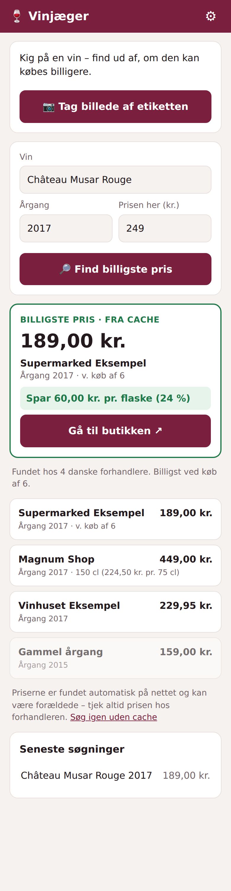
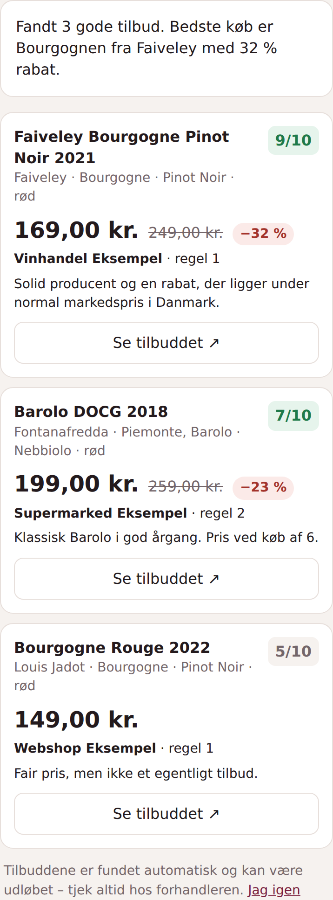

# 🍷 Vinjæger

En lille mobil-webapp: Du står med en vin i hånden – tag et billede af etiketten
(eller scan stregkoden / skriv navnet), og Vinjæger finder ud af, hvor den
ellers sælges i Danmark, og hvor den er billigst.



## Sådan virker det

1. **Genkend vinen** – billedet sendes til Claude (vision), som læser producent,
   vinnavn, årgang m.m. af etiketten.
2. **Find priser** – Claude søger nettet igennem (web search + web fetch) efter
   danske forhandlere, åbner produktsiderne og aflæser prisen. Kun priser, der
   står på en side Claude faktisk har åbnet, kommer med.
3. **Sammenlign** – serveren fjerner dubletter, omregner til pris pr. 75 cl,
   sorterer udsolgte og forkerte årgange bagerst og fremhæver den billigste.
   Skriver du prisen i butikken, hvor du står, viser appen, hvor meget du sparer.

Der er ingen faste scrapers for de enkelte butikker, så den går ikke i stykker,
når en webshop ændrer layout – og den finder også små vinhandlere.

## Tilbudsjæger

Fanen **Tilbudsjæger** vender det om: I stedet for at tjekke én vin beskriver
du, hvad du kan lide, og en agent finder de bedste tilbud lige nu.



- Lav en eller flere **profiler** (fx "Weekendvin", "Gemmevin"). De gemmes i
  browseren på din telefon.
- En profil består af **regler**. En regel kan have type (rød, hvid, rosé ...),
  områder, druer, producenter/huse og en max pris. En vin skal passe til alle
  udfyldte felter i én regel – fx *rød + Bourgogne* eller *Nebbiolo fra
  Barolo/Barbaresco under 300 kr.*
- Generelle krav: max pris pr. flaske, mindste rabat i % og fritekstønsker
  ("gerne modne årgange", "ikke naturvin").
- Agenten søger tilbuds- og kampagnesider hos vinhandlere og supermarkeder,
  åbner siderne, aflæser tilbuds- og normalpris og giver hvert fund en score
  1–10 for, hvor godt et køb det er, med en kort begrundelse.
- Serveren beregner selv rabatten og fjerner fund over dine prisgrænser eller
  under din mindste rabat, så de ikke slipper igennem, selv hvis agenten tager fejl.

En jagt tager typisk 2–5 minutter og kører i baggrunden på serveren – appen
spørger løbende efter resultatet, så du kan godt lukke den imens. Samme
profil genbruger resultatet i en time (tryk "Jag igen" for en frisk jagt).
En jagt bruger op til 15 websøgninger og 25 sideopslag og koster derfor mere
end et almindeligt pristjek.

## Kom i gang

Du skal bruge en API-nøgle fra <https://console.anthropic.com>.

```bash
cd vinjaeger
pip install -r requirements.txt
export ANTHROPIC_API_KEY=sk-ant-...
uvicorn app.main:app --host 0.0.0.0 --port 8000
```

Åbn `http://<din-maskine>:8000` på telefonen og vælg **Føj til hjemmeskærm**.

Med Docker:

```bash
docker build -t vinjaeger .
docker run -p 8000:8000 -e ANTHROPIC_API_KEY=sk-ant-... -e VINJAEGER_TOKEN=hemmelig vinjaeger
```

> Kameraet i browseren kræver **HTTPS** (undtagen på `localhost`). Læg appen bag
> en reverse proxy med certifikat, fx Caddy, Nginx Proxy Manager eller
> Cloudflare Tunnel.

## Indstillinger (miljøvariabler)

| Variabel | Standard | Betydning |
|---|---|---|
| `ANTHROPIC_API_KEY` | – | Påkrævet |
| `VINJAEGER_TOKEN` | (tom) | Adgangskode. Sæt den, hvis appen er tilgængelig fra internettet, så andre ikke bruger dine API-kreditter. Indtastes under ⚙︎ i appen |
| `VINJAEGER_CACHE_HOURS` | `6` | Hvor længe en søgning genbruges |
| `VINJAEGER_MODEL` | `claude-opus-5-5` | Claude-model |

## Godt at vide

- **Pris pr. søgning:** En prissøgning bruger op til 8 websøgninger og 12
  sideopslag. Gentagne søgninger kommer fra cachen.
- **Tid:** En søgning tager typisk 30–90 sekunder, fordi siderne faktisk åbnes.
- **Stregkodescanning** bruger browserens `BarcodeDetector` (Chrome på Android).
  Hvor den ikke findes (fx iPhone), vises knappen ikke – brug foto af etiketten.
- Priserne findes automatisk og kan være forkerte eller forældede – tjek altid
  hos forhandleren før køb.

## API

- `POST /api/identify` – multipart-felt `image` → genkendt vin (JSON)
- `GET /api/search?q=...&vintage=2019&ean=...&refresh=true` → tilbud sorteret efter pris
- `POST /api/deals` – JSON med kriterier → job (`id`, `status`)
- `GET /api/deals/{id}` → `running`, `done` (med tilbud) eller `error`
- `GET /api/health`

## Udvikling

```bash
pip install -r requirements-dev.txt
python -m pytest
```
